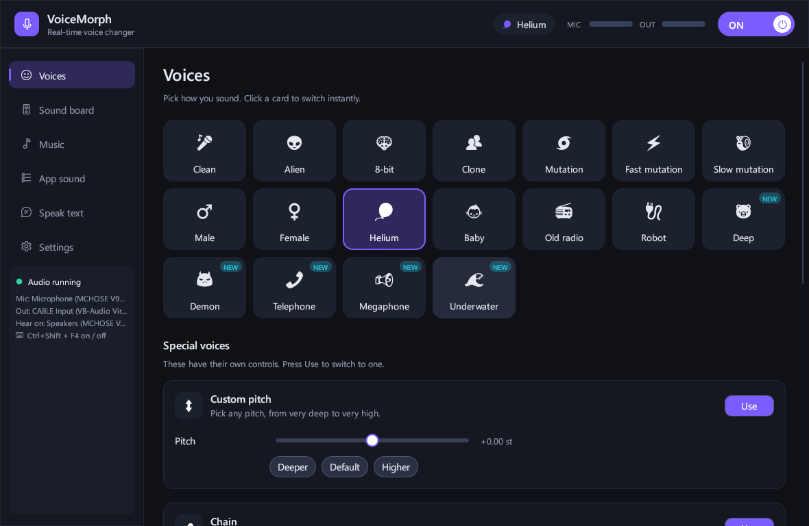
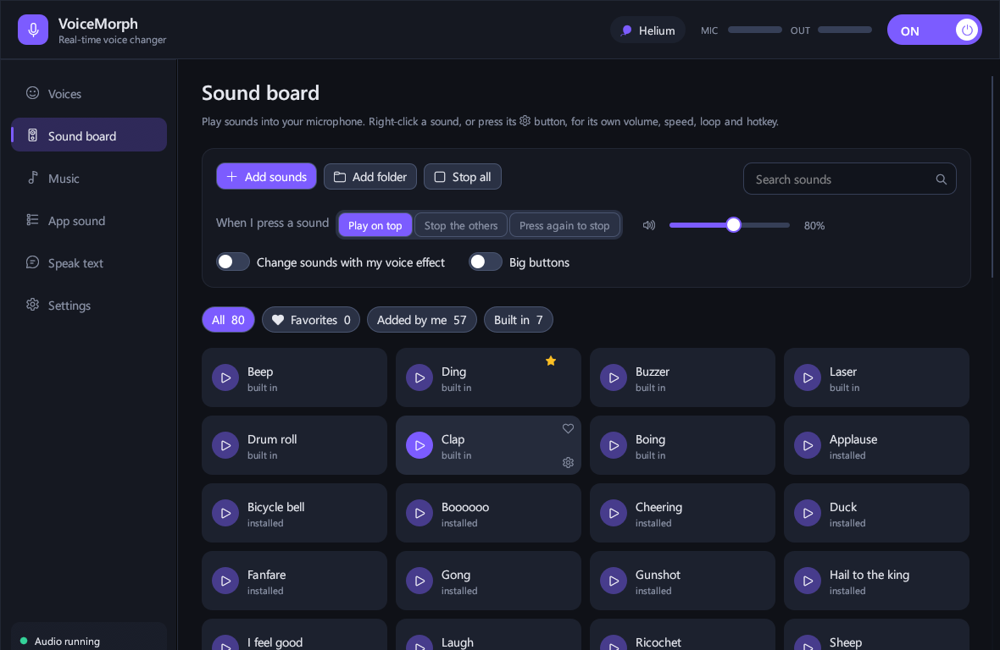
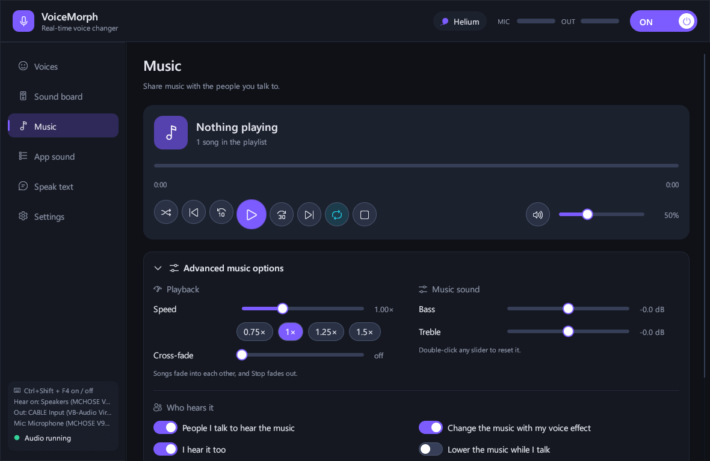
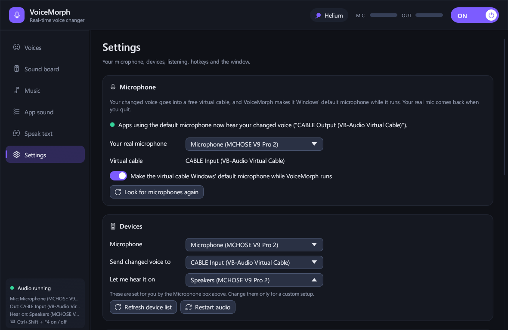

# VoiceMorph

Real-time voice changer for Windows, written in Rust. It changes your microphone voice live for calls,
games and streams. It also has a sound board, a music player and offline text to speech that play into
the same microphone.



## Features

- **20+ voice effects**: Alien, 8-bit, Clone, Mutation (normal/fast/slow), Male, Female, Helium, Baby,
  Old radio, Robot, Deep, Demon, Telephone, Megaphone, Underwater, plus **Custom pitch** and a
  **Chain** that runs up to 4 effects one after another.
- **Room effects**: Cave, City hall, Chorus, Ghost, Big room, with an amount slider.
- **Vocoder**: 18 bands with built-in synth carriers.
- **Tone & cleanup**: bass/treble (±30 dB), output boost, mic volume, spectral noise removal and a silence gate.
- **Sound board**: per-sound volume, speed, loop and favorites. Hotkey + 1…9/0 slots, search and filters,
  drag and drop.
- **Music player**: playlist, seek, repeat/shuffle, speed 0.5–2×, cross-fade, music EQ, and
  **auto-ducking** that turns the music down while you talk.
- **App sound into the mic**: sends audio from any program (e.g. a browser) into your call via
  Windows per-process loopback.
- **Speak text**: offline text to speech with the Windows voices.
- **Global hotkeys** (default Ctrl+Shift): F4 on/off, F8/F9 previous/next voice, F10 stop sounds,
  F11 music, F12 starred sound.
- **Tray icon**: closing the window hides it to the tray, and hotkeys, music and sounds keep working.

| Sound board | Music | Settings |
|---|---|---|
|  |  |  |

## Requirements

- Windows 10/11 (x64)
- [VB-CABLE](https://vb-audio.com/Cable/), a free virtual audio cable

## How it works

VoiceMorph sends your changed voice into the virtual cable. While the app runs, it makes **CABLE Output**
the Windows default microphone, so apps that use the default mic hear the changed voice. You can also pick
"CABLE Output" by hand in Discord, OBS, a game and so on. Your original default microphone comes back
when you quit.

## Install

1. Install [VB-CABLE](https://vb-audio.com/Cable/) and reboot if it asks you to.
2. Download `voicemorph.exe` from [Releases](../../releases/latest) and run it. No installer is needed.
3. Pick your real microphone in **Settings** and choose a voice.

Settings are saved in `%APPDATA%`.

## Build from source

```bash
cargo build --release
```

The binary is written to `target/release/voicemorph.exe`.

## Notes

The effect parameters are documented in [MECHANICS.md](MECHANICS.md). VoiceMorph is an independent project
and is not affiliated with Clownfish Voice Changer. If that program is installed, VoiceMorph can also use
its sound and vocoder carrier files.

## License

[MIT](LICENSE)
